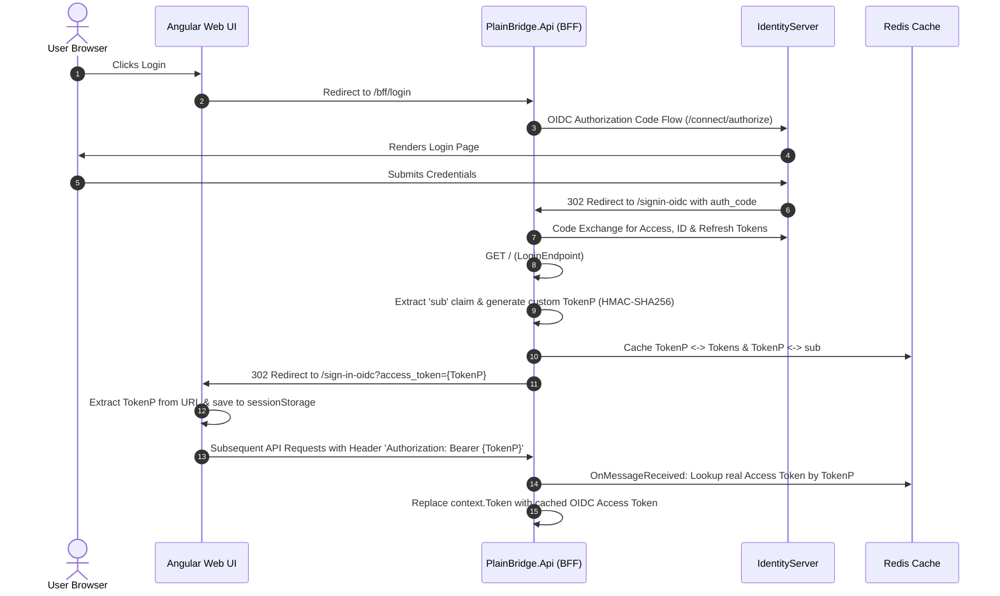
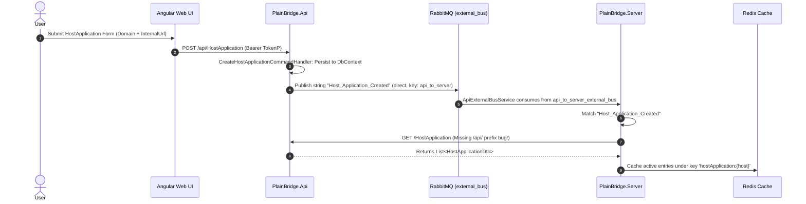
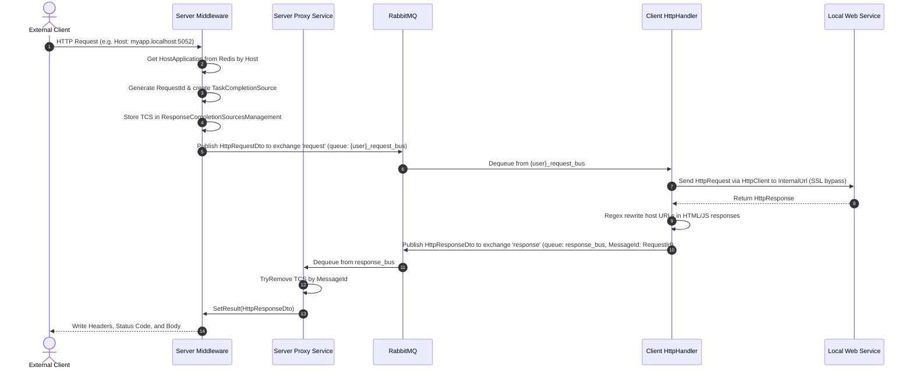
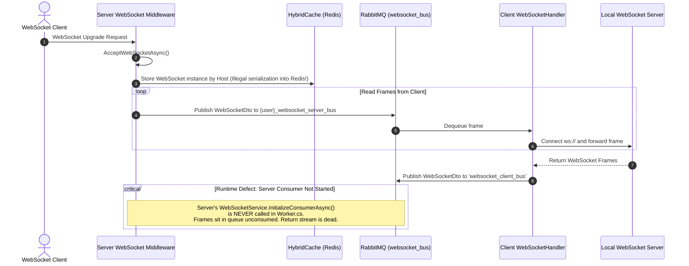
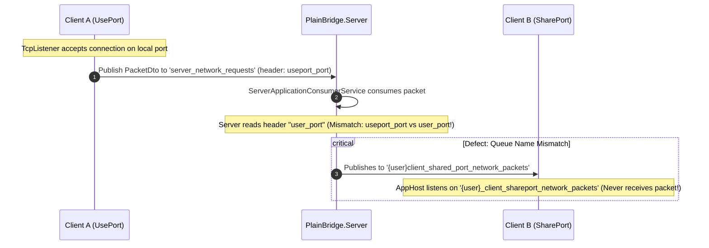
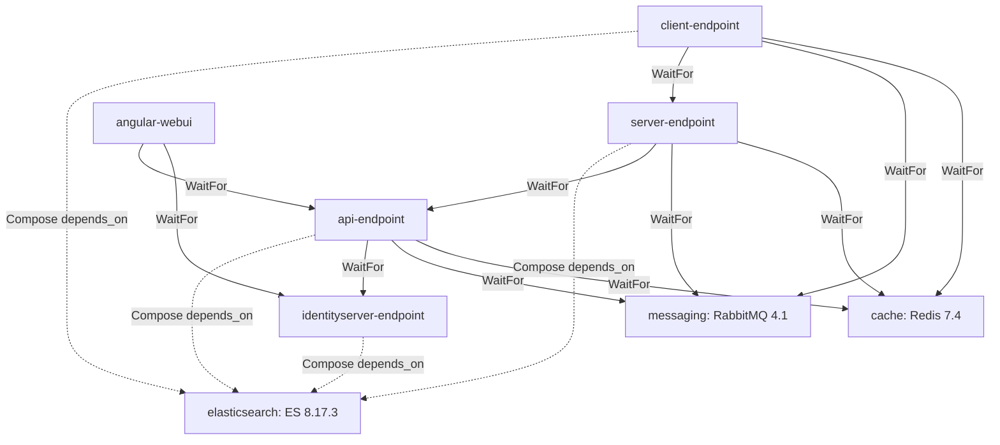

Ran command: List directory contents (`Get-ChildItem -Recurse -Depth 2 | Select-Object FullName, Mode, Length | Format-Table -AutoSize`)
Viewed README.md:1-199
Ran command: Find all csproj and esproj (`Get-ChildItem -Recurse -Include *.csproj, *.esproj, package.json | Select-Object FullName`)
Checked task Find all csproj and esproj
Killed task Find all csproj and esproj
Ran command: List project files excluding bin/obj/node_modules (`Get-ChildItem -Recurse -File | Where-Object { $_.FullName -notmatch '\\(bin|obj|node_modules|\.git)\\' -and ($_.Extension -in '.csproj', '.esproj', '.sln', '.slnx') } | Select-Object FullName`)
Checked task List project files excluding bin/obj/node_modules
Viewed task-12.log:1-29
Checked task List project files excluding bin/obj/node_modules
Killed task List project files excluding bin/obj/node_modules
Viewed cookies.txt:1-10
Viewed headers.txt:1-24
Viewed .env:1-53
Viewed docker-compose.yaml:1-150
Viewed docker-compose.yaml:151-208
Viewed Program.cs:2-151
Ran command: List AppHost directory contents (`Get-ChildItem -Path "src\PlainBridge.AppHost" -Recurse | Select-Object FullName`)
Checked task List AppHost directory contents
Ran command: List AppHost source files (`Get-ChildItem -Path "src\PlainBridge.AppHost" -Recurse -File | Where-Object { $_.FullName -notmatch '\\(bin|obj)\\' } | Select-Object FullName`)
Viewed AppHost.cs:1-136
Viewed Extensions.cs:1-140
Ran command: List PlainBridge.Shared files (`Get-ChildItem -Path "src\PlainBridge.Shared" -Recurse -File | Where-Object { $_.FullName -notmatch '\\(bin|obj)\\' } | Select-Object FullName`)
Checked task List PlainBridge.Shared files
Killed task List PlainBridge.Shared files
Ran command: List all git files (`git ls-files`)
Ran command: git ls-files for Shared (`git ls-files src/PlainBridge.Shared`)
Ran command: git ls-files for IdentityServer (`git ls-files src/PlainBridge.IdentityServer`)
Ran command: git ls-files for Api (`git ls-files src/PlainBridge.Api`)
Ran command: git ls-files for Server (`git ls-files src/PlainBridge.Server`)
Ran command: git ls-files for Client (`git ls-files src/PlainBridge.Client`)
Viewed profile
Viewed Mediator.cs:1-94
Viewed HttpRequestDto.cs:1-13
Viewed HttpResponseDto.cs:1-17
Viewed WebSocketDto.cs:1-14
Viewed HostApplicationDto.cs:1-17
Viewed ServerApplicationDto.cs:1-35
Viewed Program.cs:1-96
Viewed DependencyResolver.cs:1-100
Viewed DependencyResolver.cs:101-135
Viewed Config.cs:1-108
Viewed UserEndpoint.cs:1-61
Viewed UserServices.cs:1-99
Viewed Program.cs:1-81
Viewed DependencyResolver.cs:1-160
Viewed DependencyResolver.cs:161-194
Ran command: git grep SetGetTokenPTokenAsync (`git grep -n "SetGetTokenPTokenAsync"`)
Viewed LoginEndpoint.cs:1-81
Viewed TokenService.cs:1-48
Viewed SessionService.cs:1-112
Ran command: git ls-files for Api Endpoints (`git ls-files src/PlainBridge.Api/src/PlainBridge.Api.ApiEndPoint/Endpoints`)
Viewed HostApplicationEndpoint.cs:1-109
Viewed ServerApplicationEndPoint.cs:1-110
Viewed UserEndpoint.cs:1-110
Viewed MainDbContext.cs:1-72
Viewed DependencyResolver.cs:1-32
Viewed RabbitMQEventBus.cs:1-79
Ran command: git grep PublishAsync (`git grep -n "PublishAsync"`)
Viewed ApiExternalBusService.cs:1-82
Viewed HostApplicationService.cs:1-48
Viewed PlainBridgeApiClientService.cs:1-76
Viewed appsettings.json:1-29
Viewed appsettings.Development.json:1-29
Viewed Program.cs:1-77
Viewed DependencyResolver.cs:1-75
Viewed HttpRequestProxyMiddleware.cs:1-150
Viewed HttpRequestProxyMiddleware.cs:151-186
Viewed ServerBusService.cs:1-53
Viewed Worker.cs:1-31
Viewed HttpRequestProxyService.cs:1-90
Viewed WebSocketProxyMiddleware.cs:1-39
Viewed WebSocketService.cs:1-160
Viewed CacheManagement.cs:1-36
Ran command: git grep InitializeConsumerAsync (`git grep -n "InitializeConsumerAsync"`)
Viewed ServerApplicationConsumerService.cs:1-150
Viewed Program.cs:1-82
Viewed Worker.cs:1-39
Viewed LoginEndpoint.cs:1-79
Viewed HttpRequestHandler.cs:1-94
Viewed HttpHelper.cs:1-100
Viewed HttpHelper.cs:101-160
Viewed WebSocketHandler.cs:1-94
Viewed WebSocketService.cs:1-100
Viewed SharePortSocketService.cs:1-100
Viewed UsePortSocketService.cs:1-100
Viewed UsePortSocketService.cs:101-142
Viewed package.json:1-61
Viewed app.ts:1-12
Ran command: git ls-files for Angular app (`git ls-files src/PlainBridge.Web/src/PlainBridge.Web.UI/src/app`)
Viewed auth.service.ts:1-63
Viewed sign-in-oidc.component.ts:1-49
Viewed auth.interceptor.ts:1-26
Viewed environment.ts:1-6
Viewed environment.prod.ts:1-6
Viewed appsettings.json:1-18
Viewed app-routing-module.ts:1-54
Viewed host-application.service.ts:1-40
Viewed server-application.service.ts:1-40
Viewed user.service.ts:1-35
Viewed user-registration.component.ts:1-71
Viewed ApiTests.cs:1-43
Viewed UnitTest1.cs:1-22
Viewed ServerTests.cs:1-38
Viewed ClientTests.cs:1-32
Viewed IdsTests.cs:1-32
Viewed HttpRequestProxyServiceTests.cs:1-51
Viewed ServerApplicationConsumerServiceTests.cs:1-43
Viewed ci.yml:1-61
Viewed PlainBridge.AppHost.AppHost.csproj:1-29
Viewed web-ci.yml:1-46
Ran command: dotnet --version (`dotnet --version`)

# PlainBridge Architectural & Implementation Assessment Report

---

## 1. Executive Summary

PlainBridge is an experimental distributed tunneling solution developed in **.NET 10** with **.NET Aspire 10.x / 13.x**, featuring a microservice architecture designed to expose local HTTP, WebSocket, and raw TCP services to public endpoints via a centralized relay server and local agents. The platform coordinates traffic and metadata through **Duende IdentityServer 7.x**, **RabbitMQ 4.x**, and **Redis (HybridCache)**, managed via an **Angular 22** single-page application.

While the high-level architecture demonstrates modern .NET patterns (Clean Architecture, custom mediator pipeline, Aspire orchestration, and minimal API endpoints), the codebase is in a **pre-production, incomplete development state** containing severe architectural flaws, security vulnerabilities, and runtime breaking bugs:

- **Broken Core Runtime Functions**: The WebSocket return consumer is never initialized in the server worker; TCP port forwarding (SharePort/UsePort) cannot route due to mismatched RabbitMQ queue names, mismatched header keys, and busy-spin loops; and Server-to-API communication fails due to missing route prefixes (`/api/`).
- **Critical Security Exposure**: Cleartext JWT tokens are emitted in application logs and browser URL query strings; private signing keys, session cookies, and user profile data are committed directly into source control; and hardcoded HMAC signing keys and disabled TLS certificate validation exist in production code paths.
- **In-Memory Volatility**: Both Duende IdentityServer and the core Management API utilize Entity Framework Core In-Memory databases, resulting in total data loss upon process restarts.
- **Testing & CI Gaps**: Test execution is commented out in CI workflows; integration tests consist primarily of trivial liveness checks (`Assert.NotNull`); and unit tests rely on superficial mock verifications.

---

## 2. Architecture and Service Responsibilities

### Solution Topology & Project Dependencies

```text
PlainBridge/
├── src/
│   ├── PlainBridge.AppHost/                 # Aspire AppHost orchestrator & ServiceDefaults
│   ├── PlainBridge.IdentityServer/          # Duende IdentityServer & Identity endpoints
│   ├── PlainBridge.Api/                     # Management API (Clean Architecture: Domain, App, Infra, Endpoint)
│   ├── PlainBridge.Server/                  # Public gateway & HTTP/WS/TCP proxy
│   ├── PlainBridge.Client/                  # Local tunneling agent & TCP/HTTP forwarding
│   ├── PlainBridge.Shared/                  # Shared Domain aggregates & custom Mediator
│   └── PlainBridge.Web/                     # Angular 22 frontend application
├── infra/                                   # Docker Compose definitions and environment variables
└── tests/PlainBridge.Tests/                 # Cross-service Aspire integration tests
```

### Service Responsibilities & Communication Matrix

| Service | Primary Responsibility | Upstream Dependencies | Downstream Dependencies | Communication Protocols |
| :--- | :--- | :--- | :--- | :--- |
| **PlainBridge.AppHost** | Distributed lifecycle orchestration, container provisioning, dashboard configuration | Docker daemon | All projects & infra containers | Aspire DCP / gRPC |
| **PlainBridge.IdentityServer** | OIDC Identity Provider, token issuance, user credentials & claims management | Client, API, Angular | Redis (DataProtection), In-Memory DB | HTTPS (HTTP/1.1, HTTP/2, HTTP/3) |
| **PlainBridge.Api** | Core control plane: Host & Server Application CRUD, custom token issuance (`TokenP`), BFF endpoints | Angular UI, Server | IdentityServer, Redis, RabbitMQ, In-Memory DB | REST/JSON, RabbitMQ (`external_bus`) |
| **PlainBridge.Server** | Public reverse-proxy gateway: receives incoming internet traffic, routes requests by domain | Public internet clients, Server apps | PlainBridge.Api, Redis, RabbitMQ | HTTPS, WSS, RabbitMQ (`request`, `server_bus`, etc.) |
| **PlainBridge.Client** | Local client agent: consumes commands from RabbitMQ, proxies traffic to `localhost` targets | RabbitMQ, Local apps | Localhost targets, RabbitMQ, IdentityServer | HTTP, WebSocket, Raw TCP, AMQP |
| **PlainBridge.Web** | User administrative dashboard for managing domains, applications, and credentials | End users | PlainBridge.Api, IdentityServer | HTTPS / REST |
| **PlainBridge.Shared** | Cross-cutting mediator, domain primitives, result wrappers, and message contracts | Shared library | None | In-process library |

### Dependency & Communication Flow

```
[ Angular Web UI ] ──────(HTTPS / REST)──────> [ PlainBridge.Api ]
       │                                              │
       │ (OIDC / OAuth2)                              │ (AMQP / RabbitMQ)
       ▼                                              ▼
[ PlainBridge.IdentityServer ] <─────── [ RabbitMQ Exchange: external_bus ]
                                                      │
[ Public Client ] ──(HTTPS/WSS)──> [ PlainBridge.Server ]
                                         │
                         (AMQP Requests) │ ▲ (AMQP Responses)
                                         ▼ │
                               [ RabbitMQ Messaging ]
                                         │ ▲
                         (AMQP Requests) │ │ (AMQP Responses)
                                         ▼ │
                               [ PlainBridge.Client ] ──(HTTP/TCP)──> [ Local Application ]
```

---

## 3. End-to-End Workflow Diagrams

### 3.1 Authentication & Token Exchange Flow

*Verified in [`LoginEndpoint.cs`](file:///D:/ProgrammingProjects/PlainBridge/src/PlainBridge.Api/src/PlainBridge.Api.ApiEndPoint/Endpoints/LoginEndpoint.cs), [`DependencyResolver.cs`](file:///D:/ProgrammingProjects/PlainBridge/src/PlainBridge.Api/src/PlainBridge.Api.ApiEndPoint/DependencyResolver.cs#L92-L154), and [`auth.service.ts`](file:///D:/ProgrammingProjects/PlainBridge/src/PlainBridge.Web/src/PlainBridge.Web.UI/src/app/services/auth.service.ts).*



---

### 3.2 Application / Domain Registration Flow

*Verified in [`HostApplicationEndpoint.cs`](file:///D:/ProgrammingProjects/PlainBridge/src/PlainBridge.Api/src/PlainBridge.Api.ApiEndPoint/Endpoints/HostApplicationEndpoint.cs), [`RabbitMQEventBus.cs`](file:///D:/ProgrammingProjects/PlainBridge/src/PlainBridge.Api/src/PlainBridge.Api.Infrastructure/ExternalServices/Messaging/RabbitMQEventBus.cs), and [`ApiExternalBusService.cs`](file:///D:/ProgrammingProjects/PlainBridge/src/PlainBridge.Server/src/PlainBridge.Server.Application/Services/ApiExternalBus/ApiExternalBusService.cs).*



---

### 3.3 HTTP Request Tunneling Flow

*Verified in [`HttpRequestProxyMiddleware.cs`](file:///D:/ProgrammingProjects/PlainBridge/src/PlainBridge.Server/src/PlainBridge.Server.ApiEndPoint/Middleware/HttpRequestProxyMiddleware.cs), [`HttpRequestProxyService.cs`](file:///D:/ProgrammingProjects/PlainBridge/src/PlainBridge.Server/src/PlainBridge.Server.Application/Services/HttpRequestProxy/HttpRequestProxyService.cs), [`HttpRequestHandler.cs`](file:///D:/ProgrammingProjects/PlainBridge/src/PlainBridge.Client/src/PlainBridge.Client.Application/Handler/HttpRequest/HttpRequestHandler.cs), and [`HttpHelper.cs`](file:///D:/ProgrammingProjects/PlainBridge/src/PlainBridge.Client/src/PlainBridge.Client.Application/Helpers/Http/HttpHelper.cs).*



---

### 3.4 WebSocket Tunneling Flow & Failure Point

*Verified in [`WebSocketProxyMiddleware.cs`](file:///D:/ProgrammingProjects/PlainBridge/src/PlainBridge.Server/src/PlainBridge.Server.ApiEndPoint/Middleware/WebSocketProxyMiddleware.cs), [`WebSocketService.cs`](file:///D:/ProgrammingProjects/PlainBridge/src/PlainBridge.Server/src/PlainBridge.Server.Application/Services/WebSocket/WebSocketService.cs), [`WebSocketHandler.cs`](file:///D:/ProgrammingProjects/PlainBridge/src/PlainBridge.Client/src/PlainBridge.Client.Application/Handler/WebSocket/WebSocketHandler.cs), and [`Worker.cs`](file:///D:/ProgrammingProjects/PlainBridge/src/PlainBridge.Server/src/PlainBridge.Server.ApiEndPoint/Worker.cs).*



---

### 3.5 Raw TCP Port Tunneling (SharePort / UsePort) & Mismatch Points

*Verified in [`ServerApplicationConsumerService.cs`](file:///D:/ProgrammingProjects/PlainBridge/src/PlainBridge.Server/src/PlainBridge.Server.Application/Services/ServerApplicationConsumer/ServerApplicationConsumerService.cs), [`SharePortSocketService.cs`](file:///D:/ProgrammingProjects/PlainBridge/src/PlainBridge.Client/src/PlainBridge.Client.Application/Services/SharePortSocket/SharePortSocketService.cs), and [`UsePortSocketService.cs`](file:///D:/ProgrammingProjects/PlainBridge/src/PlainBridge.Client/src/PlainBridge.Client.Application/Services/UsePortSocket/UsePortSocketService.cs).*



---

## 4. Implementation Status by Service

### 4.1 PlainBridge.AppHost & ServiceDefaults
- **Status:** **Partially Implemented / Inconsistent**
- **Implemented:**
  - Aspire AppHost orchestration registering Redis, RedisInsight, RabbitMQ with Management, IdentityServer, API, Server, Client, and Angular Web UI in [`AppHost.cs`](file:///D:/ProgrammingProjects/PlainBridge/src/PlainBridge.AppHost/PlainBridge.AppHost.AppHost/AppHost.cs).
  - OpenTelemetry configuration and default health check extensions in [`Extensions.cs`](file:///D:/ProgrammingProjects/PlainBridge/src/PlainBridge.AppHost/PlainBridge.AppHost.ServiceDefaults/Extensions.cs).
- **Missing / Placeholders / Inconsistencies:**
  - Elasticsearch registration is commented out in [`AppHost.cs#L88-L110`](file:///D:/ProgrammingProjects/PlainBridge/src/PlainBridge.AppHost/PlainBridge.AppHost.AppHost/AppHost.cs#L88-L110), but client extensions still attempt to bind to `elasticsearch` in endpoints outside development.
  - `builder.Services.BuildServiceProvider()` is invoked at runtime inside configuration binding ([`AppHost.cs#L27`](file:///D:/ProgrammingProjects/PlainBridge/src/PlainBridge.AppHost/PlainBridge.AppHost.AppHost/AppHost.cs#L27)).
  - Health checks `/health` and `/alive` are conditionally enabled *only* in Development mode ([`Extensions.cs#L125-L135`](file:///D:/ProgrammingProjects/PlainBridge/src/PlainBridge.AppHost/PlainBridge.AppHost.ServiceDefaults/Extensions.cs#L125-L135)), breaking container orchestration readiness probes in Production.

### 4.2 PlainBridge.IdentityServer
- **Status:** **Partially Implemented / Prototype Quality**
- **Implemented:**
  - Duende IdentityServer configuration with InMemory clients (`client`, `back`, `bff`) and scopes in [`Config.cs`](file:///D:/ProgrammingProjects/PlainBridge/src/PlainBridge.IdentityServer/src/PlainBridge.IdentityServer.EndPoint/Config.cs).
  - Razor Pages for interactive login, logout, and consent.
  - Minimal API endpoints for user creation, update, and password changes in [`UserEndpoint.cs`](file:///D:/ProgrammingProjects/PlainBridge/src/PlainBridge.IdentityServer/src/PlainBridge.IdentityServer.EndPoint/Endpoints/UserEndpoint.cs).
- **Missing / Placeholders / Inconsistencies:**
  - Persistence uses EF Core InMemory database ([`DependencyResolver.cs#L80`](file:///D:/ProgrammingProjects/PlainBridge/src/PlainBridge.IdentityServer/src/PlainBridge.IdentityServer.EndPoint/DependencyResolver.cs#L80)).
  - Google OAuth external authentication contains literal placeholder strings `"copy client ID from Google here"` ([`DependencyResolver.cs#L64-L65`](file:///D:/ProgrammingProjects/PlainBridge/src/PlainBridge.IdentityServer/src/PlainBridge.IdentityServer.EndPoint/DependencyResolver.cs#L64-L65)).
  - Server shutdown hooks register a blocking `Console.ReadKey()` call ([`DependencyResolver.cs#L99`](file:///D:/ProgrammingProjects/PlainBridge/src/PlainBridge.IdentityServer/src/PlainBridge.IdentityServer.EndPoint/DependencyResolver.cs#L99)), causing container environments to hang or crash on SIGTERM.
  - Private JSON Web Keys (`is-signing-key-*.json`) are checked into the Git repository.

### 4.3 PlainBridge.Api
- **Status:** **Partially Implemented / Security Flaws Present**
- **Implemented:**
  - Custom CQRS mediator pattern and handlers for `HostApplication`, `ServerApplication`, and `User` entities.
  - Minimal API endpoints in [`HostApplicationEndpoint.cs`](file:///D:/ProgrammingProjects/PlainBridge/src/PlainBridge.Api/src/PlainBridge.Api.ApiEndPoint/Endpoints/HostApplicationEndpoint.cs), [`ServerApplicationEndPoint.cs`](file:///D:/ProgrammingProjects/PlainBridge/src/PlainBridge.Api/src/PlainBridge.Api.ApiEndPoint/Endpoints/ServerApplicationEndPoint.cs), and [`UserEndpoint.cs`](file:///D:/ProgrammingProjects/PlainBridge/src/PlainBridge.Api/src/PlainBridge.Api.ApiEndPoint/Endpoints/UserEndpoint.cs).
  - Event publishing to RabbitMQ direct exchange `external_bus` in [`RabbitMQEventBus.cs`](file:///D:/ProgrammingProjects/PlainBridge/src/PlainBridge.Api/src/PlainBridge.Api.Infrastructure/ExternalServices/Messaging/RabbitMQEventBus.cs).
- **Missing / Placeholders / Inconsistencies:**
  - Persistence uses EF Core InMemory database ([`DependencyResolver.cs#L24`](file:///D:/ProgrammingProjects/PlainBridge/src/PlainBridge.Api/src/PlainBridge.Api.Infrastructure/DependencyResolver.cs#L24)).
  - Event payloads sent over RabbitMQ are hardcoded string literals (e.g., `"Host_Application_Created"`) rather than domain event models with entity IDs.
  - RabbitMQ channels are instantiated via `CreateChannelAsync()` on every message publish and are **never disposed**, causing memory and connection leaks ([`RabbitMQEventBus.cs#L14`](file:///D:/ProgrammingProjects/PlainBridge/src/PlainBridge.Api/src/PlainBridge.Api.Infrastructure/ExternalServices/Messaging/RabbitMQEventBus.cs#L14)).
  - Custom JWT signing key is hardcoded in source code ([`TokenService.cs#L35`](file:///D:/ProgrammingProjects/PlainBridge/src/PlainBridge.Api/src/PlainBridge.Api.Application/Services/Token/TokenService.cs#L35)).

### 4.4 PlainBridge.Server
- **Status:** **Partially Implemented / Severely Defective**
- **Implemented:**
  - Reverse proxy middleware for HTTP request handling in [`HttpRequestProxyMiddleware.cs`](file:///D:/ProgrammingProjects/PlainBridge/src/PlainBridge.Server/src/PlainBridge.Server.ApiEndPoint/Middleware/HttpRequestProxyMiddleware.cs).
  - RabbitMQ message correlation mechanism via in-memory `TaskCompletionSource` in [`ResponseCompletionSourcesManagement.cs`](file:///D:/ProgrammingProjects/PlainBridge/src/PlainBridge.Server/src/PlainBridge.Server.Application/Management/ResponseCompletionSources/ResponseCompletionSourcesManagement.cs).
- **Missing / Placeholders / Inconsistencies:**
  - **Dead Route:** When querying API applications, calls are made to `${PlainBridgeApiAddress}/HostApplication` rather than `/api/HostApplication` ([`PlainBridgeApiClientService.cs#L30`](file:///D:/ProgrammingProjects/PlainBridge/src/PlainBridge.Server/src/PlainBridge.Server.Application/Services/PlainBridgeApiClient/PlainBridgeApiClientService.cs#L30)), resulting in HTTP 404 responses.
  - **Dead Consumer:** `WebSocketService.InitializeConsumerAsync()` is omitted from [`Worker.cs#L20-L22`](file:///D:/ProgrammingProjects/PlainBridge/src/PlainBridge.Server/src/PlainBridge.Server.ApiEndPoint/Worker.cs#L20-L22), rendering return WebSocket streams non-functional.
  - **Illegal HybridCache Usage:** `IWebSocketManagement` instances (wrapping live OS sockets) are passed to `HybridCache.GetOrCreateAsync` ([`CacheManagement.cs#L28-L31`](file:///D:/ProgrammingProjects/PlainBridge/src/PlainBridge.Server/src/PlainBridge.Server.Application/Management/Cache/CacheManagement.cs#L28-L31)), which attempts to serialize non-serializable network handles to Redis L2 cache.
  - **No Scale-Out:** The HTTP response queue (`response_bus`) is shared across all server instances. In multi-instance deployments, instances steal each other's response messages, leading to 100-second gateway timeouts.
  - RabbitMQ channels are leaked on every incoming request in [`HttpRequestProxyMiddleware.cs#L97`](file:///D:/ProgrammingProjects/PlainBridge/src/PlainBridge.Server/src/PlainBridge.Server.ApiEndPoint/Middleware/HttpRequestProxyMiddleware.cs#L97).

### 4.5 PlainBridge.Client
- **Status:** **Partially Implemented / Defective**
- **Implemented:**
  - Local HTTP proxy handler forwarding requests via `HttpClient` in [`HttpRequestHandler.cs`](file:///D:/ProgrammingProjects/PlainBridge/src/PlainBridge.Client/src/PlainBridge.Client.Application/Handler/HttpRequest/HttpRequestHandler.cs).
  - Regex replacement of host headers and internal URLs in [`HttpHelper.cs`](file:///D:/ProgrammingProjects/PlainBridge/src/PlainBridge.Client/src/PlainBridge.Client.Application/Helpers/Http/HttpHelper.cs).
- **Missing / Placeholders / Inconsistencies:**
  - Reads hardcoded file named `profile` from the current working directory to determine user identity ([`Worker.cs#L20-L26`](file:///D:/ProgrammingProjects/PlainBridge/src/PlainBridge.Client/src/PlainBridge.Client.ApiEndPoint/Worker.cs#L20-L26)). A valid developer `profile` file is committed into the repository root and client folder.
  - In `LoginEndpoint.cs`, if the file `profile` exists, it immediately returns `"Authorized"` without verifying credentials or session state ([`LoginEndpoint.cs#L30-L42`](file:///D:/ProgrammingProjects/PlainBridge/src/PlainBridge.Client/src/PlainBridge.Client.ApiEndPoint/Endpoints/LoginEndpoint.cs#L30-L42)).
  - SSL validation is permanently disabled in [`HttpHelper.cs#L59`](file:///D:/ProgrammingProjects/PlainBridge/src/PlainBridge.Client/src/PlainBridge.Client.Application/Helpers/Http/HttpHelper.cs#L59).
  - Broken port tunneling queue names and header conventions prevent TCP packets from ever reaching targets.
  - Busy-spin `while(true)` loops in [`UsePortSocketService.cs#L64`](file:///D:/ProgrammingProjects/PlainBridge/src/PlainBridge.Client/src/PlainBridge.Client.Application/Services/UsePortSocket/UsePortSocketService.cs#L64) consume 100% CPU when sockets disconnect.

### 4.6 PlainBridge.Shared
- **Status:** **Fully Implemented (with architectural caveats)**
- **Implemented:**
  - Lightweight custom mediator (`IMediator`, `IRequest<T>`, `IRequestHandler<T, R>`, `IPipelineBehavior`) in [`Mediator.cs`](file:///D:/ProgrammingProjects/PlainBridge/src/PlainBridge.Shared/src/PlainBridge.Shared.Application/Mediator/Mediator.cs).
  - Base aggregate and entity models with state tracking.
  - Common DTOs for HTTP and WebSocket payload representation.
- **Architectural Caveats:**
  - Mediator invokes handlers using runtime reflection (`handlerType.GetMethod("Handle").Invoke(...)`) inside a manually created DI scope for every request ([`Mediator.cs#L21-L37`](file:///D:/ProgrammingProjects/PlainBridge/src/PlainBridge.Shared/src/PlainBridge.Shared.Application/Mediator/Mediator.cs#L21-L37)), causing allocation and reflection overhead.

### 4.7 PlainBridge.Web (Angular UI)
- **Status:** **Fully Implemented UI / Inconsistent Environment Configuration**
- **Implemented:**
  - Angular 22 modular architecture with lazy-loaded modules (`host-applications`, `server-applications`, `users`, `profile`).
  - `AuthGuard` protecting dashboard and configuration routes.
  - `AuthInterceptor` injecting `Bearer` tokens from `sessionStorage`.
  - Confirmation dialogs, form validation, and dashboard overview metrics.
- **Missing / Inconsistencies:**
  - Authentication flow does not implement standard Duende BFF cookie mode; instead, it reads access tokens from query strings and stores them in browser storage.
  - `environment.ts` hardcodes `https://localhost:5051`, which mismatches README-documented ports (5001) and Docker Compose port mappings.

---

## 5. Security Assessment

### 5.1 Hardcoded Secrets and Cryptographic Misconfigurations
1. **Hardcoded Symmetric JWT Key:**
   [`TokenService.cs#L34-L35`](file:///D:/ProgrammingProjects/PlainBridge/src/PlainBridge.Api/src/PlainBridge.Api.Application/Services/Token/TokenService.cs#L34-L35):
   ```csharp
   SigningCredentials = new SigningCredentials(new SymmetricSecurityKey(Encoding.ASCII
       .GetBytes("576537ae-b3da-4393-9233-68190b1646e3")), SecurityAlgorithms.HmacSha256Signature)
   ```
   The key used to mint `TokenP` JWTs is a hardcoded GUID string in the source repository. Anyone with read access to the repo can forge administrative authentication tokens.
2. **Hardcoded OAuth Client Secrets:**
   [`Config.cs#L35`](file:///D:/ProgrammingProjects/PlainBridge/src/PlainBridge.IdentityServer/src/PlainBridge.IdentityServer.EndPoint/Config.cs#L35), [`Config.cs#L56`](file:///D:/ProgrammingProjects/PlainBridge/src/PlainBridge.IdentityServer/src/PlainBridge.IdentityServer.EndPoint/Config.cs#L56), [`Config.cs#L80`](file:///D:/ProgrammingProjects/PlainBridge/src/PlainBridge.IdentityServer/src/PlainBridge.IdentityServer.EndPoint/Config.cs#L80):
   Client secrets are hardcoded as `"secret".Sha256()`.
3. **Private IdentityServer Signing Keys in Git:**
   Files [`is-signing-key-0DC4B64548F26BFFF432AB5D01514AE4.json`](file:///D:/ProgrammingProjects/PlainBridge/src/PlainBridge.IdentityServer/src/PlainBridge.IdentityServer.EndPoint/keys/is-signing-key-0DC4B64548F26BFFF432AB5D01514AE4.json) and others are checked into the repository under `src/PlainBridge.IdentityServer/src/PlainBridge.IdentityServer.EndPoint/keys/`.
4. **Session Cookies & Auth Headers in Git:**
   Files [`cookies.txt`](file:///D:/ProgrammingProjects/PlainBridge/cookies.txt) and [`headers.txt`](file:///D:/ProgrammingProjects/PlainBridge/headers.txt) contain live session cookies (`.AspNetCore.Identity.Application`, `idsrv.session`, antiforgery tokens) and OAuth authorize redirect URLs checked into the repository root.

### 5.2 Broken BFF Pattern & Token Exposure
- **Design vs Implementation Conflict:** While the documentation states Duende BFF is used to eliminate tokens in browser JavaScript, the actual implementation bypasses BFF cookie security entirely:
  1. [`LoginEndpoint.cs#L75-L76`](file:///D:/ProgrammingProjects/PlainBridge/src/PlainBridge.Api/src/PlainBridge.Api.ApiEndPoint/Endpoints/LoginEndpoint.cs#L75-L76) transmits the bearer token directly inside the URL query string: `?access_token={tokenp}`.
  2. Tokens in URL query strings are exposed in browser history, proxy access logs, and HTTP `Referer` headers.
  3. [`LoginEndpoint.cs#L41`](file:///D:/ProgrammingProjects/PlainBridge/src/PlainBridge.Api/src/PlainBridge.Api.ApiEndPoint/Endpoints/LoginEndpoint.cs#L41) logs cleartext access tokens and TokenP tokens to application logs:
     ```csharp
     logger.LogInformation($"{sub} logged in, Token: {token}, TokenP: {tokenp}");
     ```
  4. The frontend stores tokens in `sessionStorage` ([`auth.service.ts#L40`](file:///D:/ProgrammingProjects/PlainBridge/src/PlainBridge.Web/src/PlainBridge.Web.UI/src/app/services/auth.service.ts#L40)), exposing them to cross-site scripting (XSS) extraction.

### 5.3 Authorization Flaws & Insecure Direct Object References (IDOR)
1. **Unauthenticated IdentityServer User Endpoints:**
   In [`UserEndpoint.cs`](file:///D:/ProgrammingProjects/PlainBridge/src/PlainBridge.IdentityServer/src/PlainBridge.IdentityServer.EndPoint/Endpoints/UserEndpoint.cs#L20-L58), `POST /api/User`, `PATCH /api/User`, and `PATCH /api/User/ChangePassword` do NOT require authorization. Any anonymous caller can change any user's profile and password.
2. **Missing Tenant / User Isolation (IDOR):**
   - [`HostApplicationEndpoint.cs#L24-L32`](file:///D:/ProgrammingProjects/PlainBridge/src/PlainBridge.Api/src/PlainBridge.Api.ApiEndPoint/Endpoints/HostApplicationEndpoint.cs#L24-L32): `GET /api/HostApplication` returns all applications in the database across all users without user filtering.
   - [`HostApplicationEndpoint.cs#L85-L94`](file:///D:/ProgrammingProjects/PlainBridge/src/PlainBridge.Api/src/PlainBridge.Api.ApiEndPoint/Endpoints/HostApplicationEndpoint.cs#L85-L94): `DELETE /api/HostApplication/{id}` deletes the aggregate without validating that the authenticated user owns it.
   - [`HostApplicationEndpoint.cs#L97-L105`](file:///D:/ProgrammingProjects/PlainBridge/src/PlainBridge.Api/src/PlainBridge.Api.ApiEndPoint/Endpoints/HostApplicationEndpoint.cs#L97-L105): `PATCH /api/HostApplication/UpdateState/{id}/{isActive}` modifies state without ownership validation.
   - The same vulnerabilities exist in `ServerApplicationEndPoint.cs` ([`GetAllServerApplications`](file:///D:/ProgrammingProjects/PlainBridge/src/PlainBridge.Api/src/PlainBridge.Api.ApiEndPoint/Endpoints/ServerApplicationEndPoint.cs#L24), [`DeleteServerApplication`](file:///D:/ProgrammingProjects/PlainBridge/src/PlainBridge.Api/src/PlainBridge.Api.ApiEndPoint/Endpoints/ServerApplicationEndPoint.cs#L87)).

### 5.4 Disabled TLS Validation & Weak Credentials
- **TLS Validation Bypassed:** In [`HttpHelper.cs#L59`](file:///D:/ProgrammingProjects/PlainBridge/src/PlainBridge.Client/src/PlainBridge.Client.Application/Helpers/Http/HttpHelper.cs#L59):
  ```csharp
  handler.ServerCertificateCustomValidationCallback = (sender, cert, chain, sslPolicyErrors) => { return true; };
  ```
  All certificate checks are bypassed, exposing client agent HTTP forwarding to Man-In-The-Middle (MITM) attacks.
- **Weak Password Policies:** [`DependencyResolver.cs#L46-L52`](file:///D:/ProgrammingProjects/PlainBridge/src/PlainBridge.IdentityServer/src/PlainBridge.IdentityServer.EndPoint/DependencyResolver.cs#L46-L52):
  Password complexity rules are turned off (`RequiredLength = 4`, no digit, no lowercase, no uppercase, no non-alphanumeric required).

---

## 6. Infrastructure and Deployment

### 6.1 Aspire vs. Docker Compose Divergence

There is a significant configuration mismatch between .NET Aspire (`AppHost`) and Docker Compose (`infra/docker-compose.yaml`):

| Resource / Parameter | Aspire AppHost (`appsettings.json`) | Docker Compose (`infra/.env`) | README Documentation |
| :--- | :--- | :--- | :--- |
| **API Endpoint HTTPS Port** | `5051` | `5001` | `5001` |
| **Server Endpoint HTTPS Port** | `5052` | `5002` | `5002` |
| **IdentityServer HTTPS Port** | `5053` | `5003` | `5003` |
| **Web UI Port** | `5054` | `5004` | `5004` |
| **Client Endpoint HTTPS Port** | `5055` | `5005` | `5005` |
| **Elasticsearch** | Commented Out | Enabled (`8.17.3`) | "Optional non-Dev" |

### 6.2 Service Startup Dependencies & Readiness Graph



### 6.3 Deployment & Container Issues
1. **Container Port Conflict:** In `server-endpoint` [`Program.cs#L51`](file:///D:/ProgrammingProjects/PlainBridge/src/PlainBridge.Server/src/PlainBridge.Server.ApiEndPoint/Program.cs#L51), Kestrel binds explicitly to `SERVER_PROJECT_PORT` (default 5052) without checking `DOTNET_RUNNING_IN_CONTAINER`, while `docker-compose.yaml` maps from container port `DEFAULT_HTTPS_PORT=8443`.
2. **Missing Database Containers:** Neither Aspire nor Docker Compose declares a persistent relational database service (PostgreSQL, SQL Server). All data is stored in ephemeral process memory.

---

## 7. Testing and Observability

### 7.1 Existing Tests and Coverage Assessment

The testing suite comprises six test projects:
- `tests/PlainBridge.Tests` (Root Aspire testing)
- `src/PlainBridge.Api/tests/PlainBridge.Api.Tests`
- `src/PlainBridge.Server/tests/PlainBridge.Server.Tests`
- `src/PlainBridge.Client/tests/PlainBridge.Client.Tests`
- `src/PlainBridge.IdentityServer/tests/PlainBridge.IdentityServer.Tests`
- `src/PlainBridge.Web/src/PlainBridge.Web.UI` (Karma/Jasmine specs)

#### Critical Testing Deficiencies:
1. **Placeholder & Vacuous Assertions:**
   - [`UnitTest1.cs#L19`](file:///D:/ProgrammingProjects/PlainBridge/tests/PlainBridge.Tests/UnitTest1.cs#L19):
     ```csharp
     Assert.True(true);
     ```
   - [`ApiTests.cs#L38`](file:///D:/ProgrammingProjects/PlainBridge/tests/PlainBridge.Tests/Api/ApiTests.cs#L38), [`ClientTests.cs#L29`](file:///D:/ProgrammingProjects/PlainBridge/tests/PlainBridge.Tests/Client/ClientTests.cs#L29), [`ServerTests.cs#L32`](file:///D:/ProgrammingProjects/PlainBridge/tests/PlainBridge.Tests/Server/ServerTests.cs#L32): Tests only verify `Assert.NotNull(res)` on Aspire `ResourceNotifications` without testing actual tunneling, proxying, or payload delivery.
2. **Superficial Unit Test Mocks:**
   - [`HttpRequestProxyServiceTests.cs#L45-L46`](file:///D:/ProgrammingProjects/PlainBridge/src/PlainBridge.Server/tests/PlainBridge.Server.Tests/UnitTests/Services/HttpRequestProxyServiceTests.cs#L45-L46) only verifies that `CreateChannelAsync` and `InitializeAsync` were called once on mocks. They do not test message consumption, cancellation, serialization, or error handling.
3. **CI Testing Disabled:**
   - In [`.github/workflows/ci.yml#L45-L53`](file:///D:/ProgrammingProjects/.github/workflows/ci.yml#L45-L53), the `Test` step is completely commented out.
   - In [`.github/workflows/web-ci.yml#L36-L38`](file:///D:/ProgrammingProjects/.github/workflows/web-ci.yml#L36-L38), Angular unit test execution is also commented out.
   - [`.github/workflows/ci.yml#L22`](file:///D:/ProgrammingProjects/.github/workflows/ci.yml#L22) specifies .NET SDK `9.0.x`, which cannot build the solution's `net10.0` projects.
   - [`.github/workflows/web-ci.yml#L7`](file:///D:/ProgrammingProjects/.github/workflows/web-ci.yml#L7) specifies invalid paths (`src/PlainBridge.Web/PlainBridge.Web.UI/**` missing the intermediate `src/` folder), causing the web CI to never trigger.

### 7.2 Observability and Resilience
- **Logging:** Structured logging is configured with Serilog and OpenTelemetry. However, sensitive tokens are written to standard logs, and Elasticsearch sinks are configured only for non-development environments.
- **Resilience:** HttpClient uses standard resilience (`AddStandardResilienceHandler()`), but messaging lack dead-letter exchanges (DLX), exponential backoff, or poison message handling.

---

## 8. Critical Findings (Prioritized by Severity)

### Priority 0: Blocker / Critical Defects

1. **Broken TCP Port Tunneling (SharePort / UsePort):**
   - Queue name mismatch: Server publishes to `${user}client_shared_port_network_packets` ([`ServerApplicationConsumerService.cs#L78`](file:///D:/ProgrammingProjects/PlainBridge/src/PlainBridge.Server/src/PlainBridge.Server.Application/Services/ServerApplicationConsumer/ServerApplicationConsumerService.cs#L78)), but Client listens on `${username}_client_shareport_network_packets` ([`SharePortSocketService.cs#L26`](file:///D:/ProgrammingProjects/PlainBridge/src/PlainBridge.Client/src/PlainBridge.Client.Application/Services/SharePortSocket/SharePortSocketService.cs#L26)).
   - Response queue mismatch: Server publishes to `${user}_client_user_port_network_packets` ([`ServerApplicationConsumerService.cs#L135`](file:///D:/ProgrammingProjects/PlainBridge/src/PlainBridge.Server/src/PlainBridge.Server.Application/Services/ServerApplicationConsumer/ServerApplicationConsumerService.cs#L135)), but Client listens on `${username}_client_useport_network_packets` ([`UsePortSocketService.cs#L99`](file:///D:/ProgrammingProjects/PlainBridge/src/PlainBridge.Client/src/PlainBridge.Client.Application/Services/UsePortSocket/UsePortSocketService.cs#L99)).
   - Header name mismatch: Server expects `"user_port"`, Client sends `"useport_port"`; Client expects `"sharedport_port"`, Server sends `"shared_port"`.
   - Infinite busy-spin loop in [`UsePortSocketService.cs#L64-L91`](file:///D:/ProgrammingProjects/PlainBridge/src/PlainBridge.Client/src/PlainBridge.Client.Application/Services/UsePortSocket/UsePortSocketService.cs#L64-L91) spins at 100% CPU on socket disconnection.
2. **WebSocket Return Consumer Never Initialized at Runtime:**
   [`Worker.cs#L20-L22`](file:///D:/ProgrammingProjects/PlainBridge/src/PlainBridge.Server/src/PlainBridge.Server.ApiEndPoint/Worker.cs#L20-L22) starts `HttpRequestProxyService`, `ServerBusService`, and `ServerApplicationConsumerService`, but fails to call `_webSocketService.InitializeConsumerAsync(cancellationToken)`. Return WebSocket messages from local clients are never consumed.
3. **Hardcoded Signing Keys and Cleartext Token Transmission:**
   Custom JWT symmetric secret `"576537ae-b3da-4393-9233-68190b1646e3"` is hardcoded in [`TokenService.cs#L35`](file:///D:/ProgrammingProjects/PlainBridge/src/PlainBridge.Api/src/PlainBridge.Api.Application/Services/Token/TokenService.cs#L35); tokens are leaked via URL query parameters in [`LoginEndpoint.cs#L75`](file:///D:/ProgrammingProjects/PlainBridge/src/PlainBridge.Api/src/PlainBridge.Api.ApiEndPoint/Endpoints/LoginEndpoint.cs#L75) and written to logs in clear text ([`LoginEndpoint.cs#L41`](file:///D:/ProgrammingProjects/PlainBridge/src/PlainBridge.Api/src/PlainBridge.Api.ApiEndPoint/Endpoints/LoginEndpoint.cs#L41)).
4. **Committed Secrets, Session Cookies, and Profile Files:**
   Live authentication session cookies and headers in [`cookies.txt`](file:///D:/ProgrammingProjects/PlainBridge/cookies.txt) and [`headers.txt`](file:///D:/ProgrammingProjects/PlainBridge/headers.txt), private signing keys in `keys/`, and cleartext user profile data in [`profile`](file:///D:/ProgrammingProjects/PlainBridge/src/PlainBridge.Client/src/PlainBridge.Client.ApiEndPoint/profile) are committed into source control.
5. **Server Routing Broken by Missing `/api/` Route Prefix:**
   [`PlainBridgeApiClientService.cs#L30`](file:///D:/ProgrammingProjects/PlainBridge/src/PlainBridge.Server/src/PlainBridge.Server.Application/Services/PlainBridgeApiClient/PlainBridgeApiClientService.cs#L30) calls `${PlainBridgeApiAddress}/HostApplication`, while `PlainBridge.Api` maps the route at `/api/HostApplication`. The server receives 404 Not Found and silently fails to load routing tables.
6. **Horizontal Scaling Failure (Shared AMQP Response Queue):**
   Server uses a single shared `response_bus` queue across all instances ([`HttpRequestProxyService.cs#L28`](file:///D:/ProgrammingProjects/PlainBridge/src/PlainBridge.Server/src/PlainBridge.Server.Application/Services/HttpRequestProxy/HttpRequestProxyService.cs#L28)). In a multi-replica server cluster, instance B consumes responses meant for instance A's in-memory `TaskCompletionSource`, causing client requests to timeout.

### Priority 1: High Severity Defects

7. **Insecure Direct Object References (IDOR):**
   Host and server application endpoints in `PlainBridge.Api` allow any authenticated user to view, update, and delete any other user's applications ([`HostApplicationEndpoint.cs#L24-L105`](file:///D:/ProgrammingProjects/PlainBridge/src/PlainBridge.Api/src/PlainBridge.Api.ApiEndPoint/Endpoints/HostApplicationEndpoint.cs#L24-L105)).
8. **Unauthenticated User Profile & Password Modification:**
   IdentityServer endpoints `POST /api/User` and `PATCH /api/User/ChangePassword` ([`UserEndpoint.cs#L20-L58`](file:///D:/ProgrammingProjects/PlainBridge/src/PlainBridge.IdentityServer/src/PlainBridge.IdentityServer.EndPoint/Endpoints/UserEndpoint.cs#L20-L58)) lack authorization checks.
9. **Resource & Memory Leaks in RabbitMQ and TaskCompletionSources:**
   - RabbitMQ channels are instantiated on every HTTP request and event publication without disposal ([`RabbitMQEventBus.cs#L14`](file:///D:/ProgrammingProjects/PlainBridge/src/PlainBridge.Api/src/PlainBridge.Api.Infrastructure/ExternalServices/Messaging/RabbitMQEventBus.cs#L14), [`HttpRequestProxyMiddleware.cs#L97`](file:///D:/ProgrammingProjects/PlainBridge/src/PlainBridge.Server/src/PlainBridge.Server.ApiEndPoint/Middleware/HttpRequestProxyMiddleware.cs#L97)).
   - Timed-out HTTP requests in [`HttpRequestProxyMiddleware.cs#L88`](file:///D:/ProgrammingProjects/PlainBridge/src/PlainBridge.Server/src/PlainBridge.Server.ApiEndPoint/Middleware/HttpRequestProxyMiddleware.cs#L88) are never purged from `ResponseCompletionSourcesManagement.Sources`, leaking memory permanently.
10. **Illegal Redis Serialization of WebSockets:**
    [`CacheManagement.cs#L28-L31`](file:///D:/ProgrammingProjects/PlainBridge/src/PlainBridge.Server/src/PlainBridge.Server.Application/Management/Cache/CacheManagement.cs#L28-L31) attempts to store active `IWebSocketManagement` instances into `HybridCache`, which uses Redis as an L2 distributed cache.
11. **Disabled SSL/TLS Certificate Validation:**
    [`HttpHelper.cs#L59`](file:///D:/ProgrammingProjects/PlainBridge/src/PlainBridge.Client/src/PlainBridge.Client.Application/Helpers/Http/HttpHelper.cs#L59) bypasses all certificate checks, enabling MITM attacks.
12. **Non-Thread-Safe Middleware Dictionary:**
    [`HttpRequestProxyMiddleware.cs#L15`](file:///D:/ProgrammingProjects/PlainBridge/src/PlainBridge.Server/src/PlainBridge.Server.ApiEndPoint/Middleware/HttpRequestProxyMiddleware.cs#L15) uses a non-thread-safe `Dictionary<string, bool>` inside singleton middleware, leading to data corruption and concurrency exceptions under load.
13. **In-Memory Volatility:**
    Both IdentityServer and API use in-memory EF Core contexts ([`DependencyResolver.cs#L80`](file:///D:/ProgrammingProjects/PlainBridge/src/PlainBridge.IdentityServer/src/PlainBridge.IdentityServer.EndPoint/DependencyResolver.cs#L80), [`DependencyResolver.cs#L24`](file:///D:/ProgrammingProjects/PlainBridge/src/PlainBridge.Api/src/PlainBridge.Api.Infrastructure/DependencyResolver.cs#L24)), causing data loss across restarts.

### Priority 2: Medium Severity Defects

14. **Port Configuration Inconsistencies:**
    Mismatched port definitions between README (5001-5005), Docker Compose (5001-5005), AppHost (5051-5055), and Angular environments (5051/5053).
15. **CI Workflows Broken and Tests Disabled:**
    Tests are commented out in CI workflows; .NET SDK version in GitHub Actions (9.0) mismatches project target framework (`net10.0`); and Angular workflow path triggers are malformed.
16. **Container Shutdown Hang:**
    [`DependencyResolver.cs#L99`](file:///D:/ProgrammingProjects/PlainBridge/src/PlainBridge.IdentityServer/src/PlainBridge.IdentityServer.EndPoint/DependencyResolver.cs#L99) calls `Console.ReadKey()` during application stopping, hanging container terminations.
17. **HybridCache Update Defect:**
    `SetGet...` cache management methods use `_hybridCache.GetOrCreateAsync(...)` ([`CacheManagement.cs#L13-L16`](file:///D:/ProgrammingProjects/PlainBridge/src/PlainBridge.Server/src/PlainBridge.Server.Application/Management/Cache/CacheManagement.cs#L13-L16)), which never updates an existing key when called with updated values.
18. **Fragile String URL Replacement:**
    Regex-based replacement of host headers in [`HttpHelper.cs#L138-L158`](file:///D:/ProgrammingProjects/PlainBridge/src/PlainBridge.Client/src/PlainBridge.Client.Application/Helpers/Http/HttpHelper.cs#L138-L158) corrupts binary/compressed payloads (gzip, br) that are treated as strings.

---

## 9. Recommended Next Steps

### Phase 1: Security & Hygiene Remediation
1. **Purge Sensitive Artifacts:** Revoke all test certificates and keys, delete committed session files (`cookies.txt`, `headers.txt`, `profile`), and remove private signing keys from Git history using `git-filter-repo` or BFG Repo-Cleaner.
2. **Eliminate Hardcoded Secrets:** Refactor `TokenService` to pull symmetric/asymmetric keys from secure configuration (e.g., Azure Key Vault or environment variables).
3. **Restore True BFF Pattern:** Remove the custom `TokenP` mechanism and URL query parameter token passing. Reconfigure the Angular app and API BFF middleware to communicate strictly via HTTP-only, SameSite Secure cookies with Antiforgery protection.
4. **Implement Tenant Authorization:** Add ownership checks to all `HostApplication` and `ServerApplication` commands and queries in `PlainBridge.Api` to enforce strict user-level isolation.
5. **Secure IdentityServer Management Endpoints:** Require authentication and authorization policies for all endpoints in `UserEndpoint.cs`.

### Phase 2: Runtime Bug Fixes & Architectural Stabilization
1. **Fix Routing & Queue Contracts:**
   - Correct the API URI in `PlainBridgeApiClientService` to `/api/HostApplication` and `/api/ServerApplication`.
   - Align all RabbitMQ queue and header names between `ServerApplicationConsumerService`, `SharePortSocketService`, and `UsePortSocketService`.
   - Eliminate the busy-spin loop in `UsePortSocketService` by checking for socket disconnects (`read == 0`) and breaking gracefully.
2. **Initialize Missing Consumers:**
   - Add `await _webSocketService.InitializeConsumerAsync(cancellationToken);` to `Worker.StartAsync` in `PlainBridge.Server`.
   - Replace `HybridCache` storage of `IWebSocketManagement` instances with an in-memory `ConcurrentDictionary`.
3. **Enable Horizontal Scaling for Server:**
   - Replace the shared `response_bus` queue with instance-specific, auto-delete queues bound to a direct exchange via instance-unique routing keys or RabbitMQ Direct Reply-To.
4. **Prevent Resource Leaks:**
   - Manage RabbitMQ channel lifecycles properly using `using` statements, channel pooling, or persistent dedicated consumer channels.
   - Ensure `ResponseCompletionSourcesManagement` entries are purged on timeouts and errors via `try/finally` blocks.
   - Replace `Dictionary<string, bool>` with `ConcurrentDictionary<string, bool>` in `HttpRequestProxyMiddleware`.

### Phase 3: Infrastructure, Persistence & Testing Alignment
1. **Introduce Persistent Storage:**
   - Provision a PostgreSQL or SQL Server container in both `AppHost` and `docker-compose.yaml`.
   - Replace EF Core InMemory databases in `PlainBridge.IdentityServer` and `PlainBridge.Api` with relational providers and EF Core migrations.
2. **Align Configuration & Ports:**
   - Standardize default ports across `appsettings.json`, `AppHost`, `docker-compose.yaml`, `infra/.env`, `environment.ts`, and `README.md`.
3. **Rebuild the CI/CD Pipeline & Test Suite:**
   - Update `.github/workflows/ci.yml` to use .NET 10 SDK and fix the Angular path trigger in `web-ci.yml`.
   - Uncomment the test execution steps in CI.
   - Replace superficial unit tests and vacuous integration assertions with comprehensive end-to-end tests covering authentication, application registration, HTTP tunneling, and WebSocket message exchange.